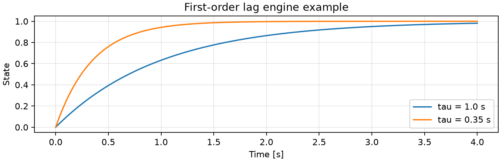
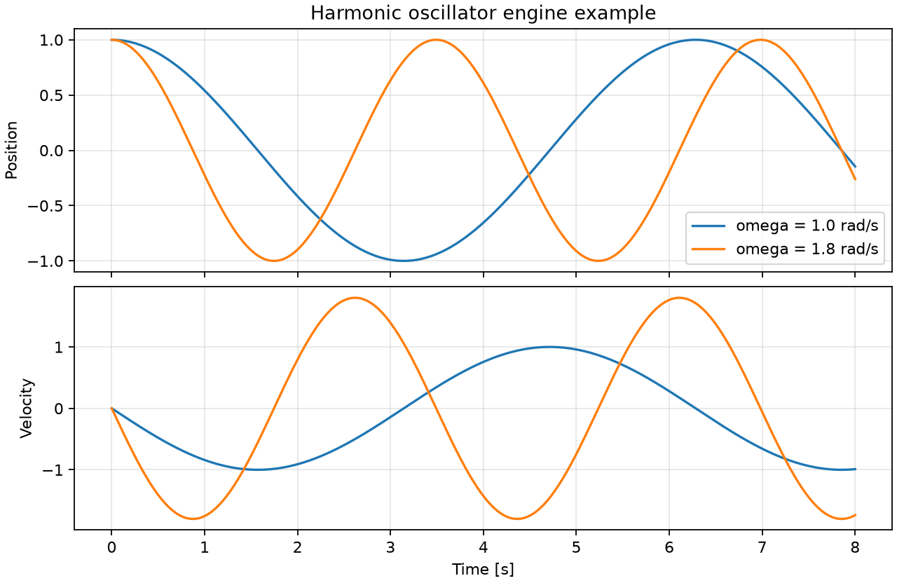
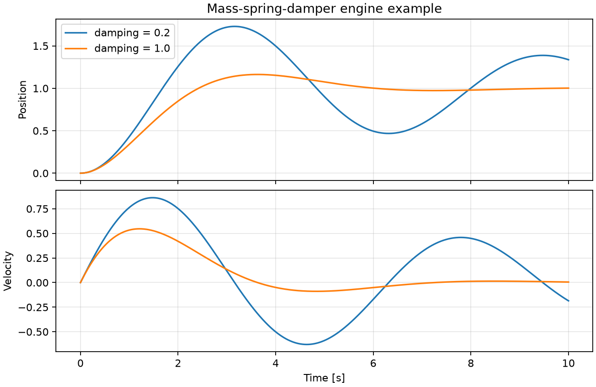
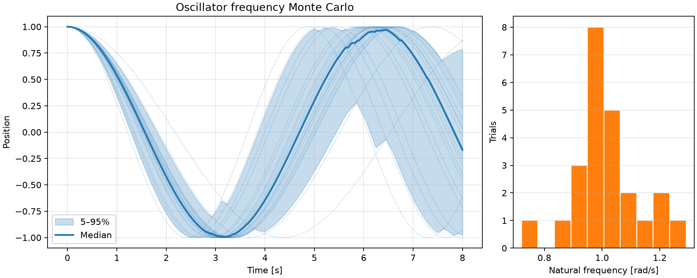
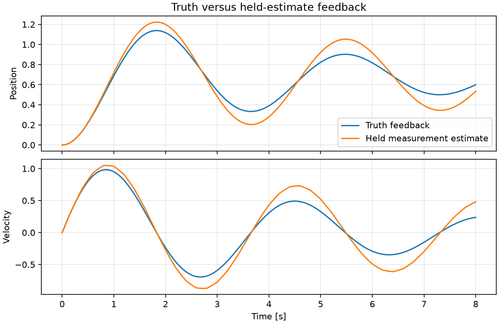

# Control, Estimation, and GNC Lab

An open, clean-room engineering lab for rebuilding and demonstrating control,
estimation, guidance, navigation, and embedded-systems skills through
reproducible simulations and later hardware-in-the-loop experiments.

## Status

Week 1 project infrastructure and a reusable fixed-step simulation kernel are
in place. The package includes test-only open-loop, Monte Carlo, and
feedback-routing examples to demonstrate the engine and its plotting path;
they are kept outside `gnc_lab.models` and are not project dynamics, control,
estimator, planner, or GNC implementations.

## Project principles

- Keep one canonical Python implementation for each algorithm.
- Keep numerical integration, timing, random streams, and run provenance in
  shared infrastructure rather than duplicating them across models.
- Make every experiment reproducible from a named configuration, seed, and
  recorded Git revision.
- Test assumptions and numerical invariants before making performance claims.
- Document model scope, limitations, and failure cases alongside results.
- Keep all public work clean-room: no employer code, data, parameters,
  drawings, or other non-public material belongs here.

## Planned workflow

The project uses Python 3.12 and [uv](https://docs.astral.sh/uv/) for a local,
locked development environment. A fresh checkout uses:

```text
uv sync
uv run ruff check .
uv run pytest
```

See [the architecture](docs/architecture.md),
[engineering conventions](docs/conventions.md), and the
[engineering log](docs/engineering-log.md). Before implementing a plant or
algorithm, read the [simulation component contracts](docs/component-contracts.md).
The three engine examples can be run and rendered with:

```text
uv run python -m gnc_lab.examples.simulation_engine_examples
```

## Simulation-engine figures

These are reproducible outputs from the test-only engine examples, not project
plant models. Each compares two open-loop cases to make the numerical
propagation and plotting path visible.











## Milestone reports

The first Quarto source report is
[Oscillator Frequency Monte Carlo](reports/oscillator-frequency-monte-carlo/oscillator-frequency-monte-carlo.qmd).
It is an infrastructure milestone, not a portfolio claim about a physical
system. Rendered report artifacts are intentionally local until an engineering
milestone is ready for review and publication.

## License

This repository is released under the [MIT License](LICENSE).
